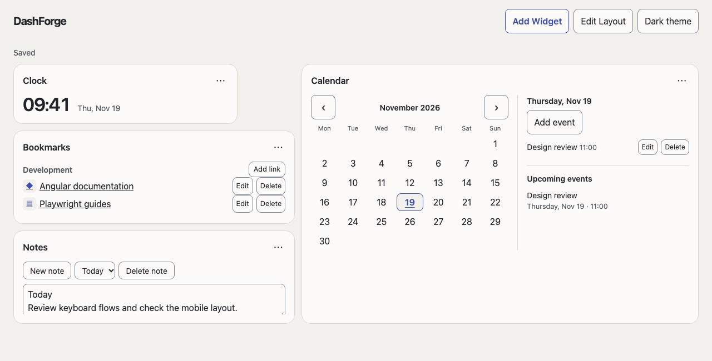

# DashForge

[Open DashForge](https://kkonstantin08.github.io/dashforge/) · [Performance results](docs/performance.md) · [CI](https://github.com/kkonstantin08/dashforge/actions/workflows/ci.yml)

DashForge is a local-first start page for links, notes, time zones, and calendar events. Add only the widgets you use, arrange them on a grid, and the browser restores your workspace the next time you open it.



[Dark theme and widget inspector](docs/images/editor-dark.png) · [Mobile layout](docs/images/dashboard-mobile.png)

## What you can do

- Add multiple instances of any widget. Drag cards to free cells, resize them, or enter exact positions and sizes in the widget inspector.
- Use different time zones and time formats for each clock. Group links, write plain-text notes, and manage local calendar events.
- Switch between light and dark themes. Edit the narrow-screen layout separately when you need a different arrangement on your phone.
- Move and resize widgets from the keyboard through the inspector. Reset positions and sizes while keeping the same widgets and content.
- Keep workspaces in IndexedDB. DashForge uses static hosting and requires no account.

## Run locally

Use Node.js 24.15 or newer within the 24.x series. The tested version is in [.nvmrc](.nvmrc).

```sh
npm ci
npm start
```

| Command | What it checks or runs |
| --- | --- |
| `npm run lint` | ESLint for TypeScript and Angular templates |
| `npm run format:check` | Prettier for source and configuration |
| `npm run typecheck` | Strict TypeScript for the application and tests |
| `npm run test:unit` | Vitest and Angular TestBed |
| `npm run test:e2e` | Playwright against a production build |
| `npm run build` | Static application in `dist/dashforge/browser` |
| `npm run preview` | Serve the built application locally |
| `npm run measure` | Browser performance measurements against the running preview |

Install the browsers once before running E2E:

```sh
npx playwright install chromium webkit
npm run test:e2e
```

For Linux CI machines, use `npx playwright install --with-deps chromium webkit`.

## Architecture

Angular standalone components use Signals, OnPush, and zoneless change detection. CSS Grid owns placement. CDK handles dragging and Pointer Events handle resizing. Both use the same placement validation as the inspector. Widget content loads by type. IndexedDB saves a versioned snapshot in a transaction and rejects stale writes from other tabs.

```text
src/app/dashboard/   editor, grid rules, inspector, and workspace state
src/app/widgets/     clock, bookmarks, notes, calendar, and lazy registry
src/app/storage/     snapshot validation and IndexedDB transactions
e2e/                 browser tests and viewport checks
docs/                research, specs, plan, TDD records, and measurements
```

## Performance

The release baseline measures initial JS and CSS, time to the first populated grid, and CPU and heap for 5, 10, and 20 widgets. It also measures repeated drag and resize, IndexedDB writes and recovery. See the results, hardware, and reproduction commands in [docs/performance.md](docs/performance.md).

## MVP limits

One workspace per origin and browser profile, with a separate narrow-screen arrangement if you customize it. The dashboard stores data on that device. Clearing the browser's site data clears the workspace. Bookmarks use local icons. Calendar events are local and can be edited without an external calendar.

## Roadmap

- Add local import and export so users can back up and transfer workspaces.
- Explore optional starter layouts that can be edited immediately.

[MIT License](LICENSE)
