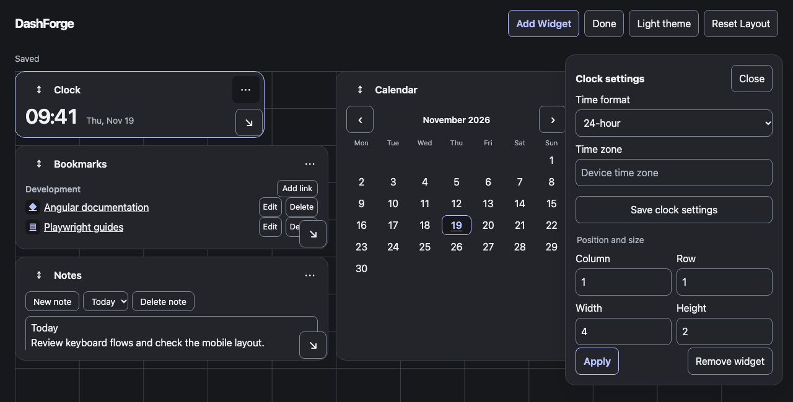

# Как пользоваться DashForge

При первом открытии на странице уже есть часы, закладки, заметки и календарь. Начните с них или добавьте ещё один экземпляр любого виджета через **Add Widget**. [Открыть DashForge](https://kkonstantin08.github.io/dashforge/)

## Соберите свой макет

1. Нажмите **Edit Layout**. На карточках появятся две ручки.
2. Потяните **↕** в заголовке, чтобы передвинуть карточку. Контур показывает, куда она встанет. Если контур сообщает о пересечении, выберите свободное место.
3. Потяните **↘** в правом нижнем углу, чтобы изменить ширину и высоту. Отпустите ручку, когда контур подходит.
4. Для точной настройки откройте **⋯** на карточке. В блоке **Position and size** введите столбец, строку, ширину и высоту в ячейках. Нажмите **Apply**. С клавиатуры до кнопки **⋯** можно дойти через `Tab` и открыть её клавишей `Enter`.
5. Нажмите **Done**, чтобы выйти из редактора. Индикатор **Saved** означает, что изменение записано в браузер.

На телефоне те же виджеты открываются в узкой раскладке. Её позиции и размеры сохраняются отдельно. Содержимое карточек общее для обеих раскладок. Если панель настроек открыта снизу, сначала закройте её, чтобы снова перемещать карточки жестом.

## Заполните виджеты

| Виджет | Первое действие |
| --- | --- |
| **Clock** | Откройте **⋯**, выберите **Time format**, укажите **Time zone**, например `Europe/Moscow`, и нажмите **Save clock settings**. Пустое поле использует часовой пояс устройства. |
| **Bookmarks** | Нажмите **Add link**, заполните **Title** и **URL**, при желании задайте **Group** и **Icon**. Нажмите **Save link**. Ссылки открываются в новой вкладке. Кнопки рядом со ссылкой позволяют её изменить или удалить. |
| **Notes** | Нажмите **New note** и введите текст. Он сохраняется автоматически. Выберите нужную заметку в списке. **Delete note** удаляет выбранную заметку. |
| **Calendar** | Выберите день и нажмите **Add event**. Введите название и, при необходимости, время. Нажмите **Save event**. Ближайшие события показаны в карточке. Значки рядом с событием открывают редактирование и удаление. |

Верхняя кнопка **Dark theme** или **Light theme** переключает оформление. Тема и содержимое восстановятся при следующем открытии в том же профиле браузера.

## Сброс или удаление

**Edit Layout** → **Reset Layout** возвращает позиции и размеры к исходной раскладке. Карточки, их содержимое и тема сохраняются. **⋯** → **Remove widget** удаляет выбранную карточку вместе с её содержимым.

Данные остаются в текущем профиле браузера. Другой браузер, устройство или приватное окно открывают собственное рабочее пространство. Очистка данных сайта удаляет сохранённый макет. Если у вас открыто несколько вкладок и видны несохранённые правки, скопируйте нужный текст перед нажатием **Load saved workspace**.
